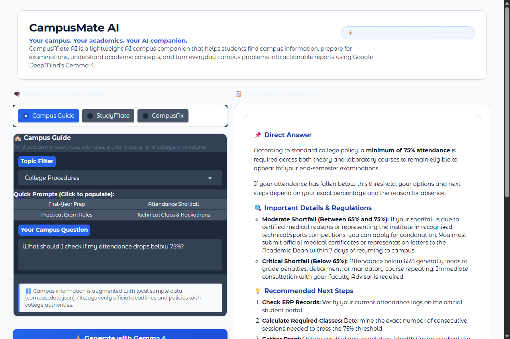

# CampusMate AI 🎓

> **"Your campus. Your academics. Your AI companion."**  
> *A lightweight, privacy-first campus intelligence system built for the IIT Hackathon ("Build for Your Campus") using Google DeepMind's Gemma 4.*

[](https://ai.google.dev/gemma)
[](https://pypi.org/project/google-genai/)
[](https://www.gradio.app/)
[](LICENSE)

---

## 📌 Application Interface



---

## 📖 Project Overview

**CampusMate AI** is a lightweight, student-centric artificial intelligence companion that helps college and engineering students find critical campus information, prepare realistically for examinations, master difficult academic concepts, and transform everyday facility or laboratory breakdowns into structured, actionable incident reports.

Rather than building an over-engineered multi-service application with databases and authentication overhead, CampusMate AI is architected as a **focused, single-screen MVP that runs entirely locally on a student's laptop** while strictly complying with hackathon resource efficiency guidelines.

---

## 🚩 Problem Statement

Students on modern technical campuses face three friction points every semester:
1. **Scattered Institutional Knowledge:** College policies, attendance regulations (e.g. 75% criteria), laboratory etiquette, and club recruitment details are fragmented across physical notice boards, outdated portals, and senior hearsay. First-years often discover critical rules only after violating them.
2. **Academic Cramming & Generic Study Advice:** Standard AI chatbots suggest unrealistic 12-hour cramming routines or generate abstract explanations without concrete engineering examples, exam pitfalls, or weak-area prioritization.
3. **Unresolved Infrastructure & Lab Faults:** Broken lab oscilloscopes, classroom projector overheating, or intermittent Wi-Fi during practical exams often go unreported because students lack a quick way to draft a professional, technical complaint to administration.

---

## 🌟 Key Features & Modes

CampusMate AI provides three specialized modes accessible on **one unified screen**:

### 1. 🏫 Campus Guide
- **Purpose:** Answers student questions about academic resources, library borrowing rules, laboratory safety norms, technical clubs, and college administrative procedures.
- **Local Grounding:** Ingests local editable reference data from `campus_data.json` into prompt context to deliver reliable, institution-aware guidance.
- **Structured Response Format:**
  - 📌 **Direct Answer:** Immediate, empathetic answer to the student's question.
  - 🔍 **Important Details & Regulations:** Clear breakdown of campus criteria and rules.
  - 💡 **Recommended Next Steps:** Actionable checklist for the student.
  - ⚠️ **Information Requiring Official Verification:** Explicit reminder of which submissions need formal approval from the Dean or Faculty Advisor.

### 2. 📚 StudyMate
- **Purpose:** Academic coaching engine with three sub-tasks:
  - **A. Create a Study Plan:** Generates realistic, time-respecting preparation roadmaps based on daily available hours, target exam date, and declared weak areas. Allocates exact percentages between theory, coding/practice problems, and revision checkpoints.
  - **B. Explain a Concept:** Breaks down complex engineering/computer science topics with core intuition, step-by-step logic, concrete code/hardware examples, common exam pitfalls, and a rapid revision summary.
  - **C. Solve or Explain an Academic Question:** Provides structured problem formulation, underlying theorems, step-by-step derivations, and verification edge cases.

### 3. 🛠️ CampusFix
- **Purpose:** Converts messy, informal facility grievances into formal, structured incident reports.
- **Output:**
  - 🏷️ **Problem Categorization:** Exact technical domain, 1-sentence factual summary, and suggested priority with rationale.
  - 📋 **Recommended Student Actions:** Verification steps (e.g., checking other devices, noting room numbers and timestamps).
  - 📄 **Formal Incident Report Draft:** Ready-to-copy email/ticket draft addressed to the campus IT Center, Estate Office, or Laboratory Superintendent.

---

## 🧠 Why Gemma 4 (`gemma-4-26b-a4b-it`)

CampusMate AI strictly integrates **`gemma-4-26b-a4b-it`** through the official Google GenAI SDK (`google-genai`).

- **Open-Weights Excellence:** Gemma 4 provides state-of-the-art reasoning and instruction following while maintaining minimal latency.
- **Strict Single-Request Execution Rule:** Every click on "Generate with Gemma 4" executes **exactly ONE model API call**. There are no nested classifier calls, multi-agent chaining loops, or background polling requests.
- **Optimized for Low Latency:** Thinking mode is omitted/disabled by default (`thinking_level="none"`), allowing direct, structured outputs without wasting tokens on unneeded meta-reasoning.
- **Safe Disk Caching:** Includes a local hash-based response cache (`.cache/`) to instantly fulfill repeated student queries during live hackathon demos with zero token consumption and zero rate-limit risk.

---

## 🛠️ Technology Stack

| Layer | Technology | Purpose |
| :--- | :--- | :--- |
| **AI Model** | `gemma-4-26b-a4b-it` | Core intelligence and reasoning engine |
| **API Client** | `google-genai>=2.28.0` | Official Google Gemini API client (`from google import genai`) |
| **Backend & Logic** | Python 3.10+ | Lightweight processing, prompt formatting, validation |
| **Frontend** | Gradio 6.x | Single-screen, reactive UI with custom modern CSS |
| **Configuration** | `python-dotenv` | Secure local `.env` environment variable management |
| **Knowledge Base** | `campus_data.json` | Local, editable campus knowledge representation |
| **Presentation** | `python-pptx` | Automated PowerPoint slide deck generation |

---

## 📁 Project Structure

```text
CampusMate-AI/
├── app.py                   # Main Gradio application (single-screen dashboard)
├── gemma_client.py          # Gemma 4 client helper (single-request, caching, error handling)
├── campus_data.json         # Local editable sample campus knowledge base
├── test_app.py              # Automated test suite (6/6 tests passing)
├── create_presentation.py   # PowerPoint deck generator script
├── requirements.txt         # Minimal production dependencies
├── .env.example             # Template for API credentials
├── .gitignore               # Strict git exclusion for secrets and cache
├── README.md                # Comprehensive documentation
├── LICENSE                  # MIT open-source license
├── SKILL.md                 # Agent Skill specification for hackathon organizers
├── assets/
│   └── campusmate_screenshot.png  # High-resolution screenshot of the running app
└── presentation/
    └── CampusMate-AI.pptx   # 6-slide widescreen hackathon pitch deck
```

---

## 🚀 Setup & Installation Instructions

### 1. Prerequisites
- Python 3.10 to 3.14 installed on your system.
- A free Gemini API Key from [Google AI Studio](https://aistudio.google.com).

### 2. Clone and Enter Project Directory
```bash
git clone <repository-url>
cd CampusMate-AI
```

### 3. Create and Activate Virtual Environment
**On Windows (PowerShell):**
```powershell
python -m venv .venv
.\.venv\Scripts\Activate.ps1
```

**On Linux / macOS:**
```bash
python3 -m venv .venv
source .venv/bin/activate
```

### 4. Install Dependencies
```bash
pip install -r requirements.txt
```

### 5. Configure API Key
Copy `.env.example` to create your local `.env` file:
```bash
cp .env.example .env
```
Open `.env` in any text editor and insert your Gemini API Key:
```env
GEMINI_API_KEY=your_actual_api_key_here
GEMMA_MODEL=gemma-4-26b-a4b-it
```

> **Security Note:** The `.env` file is strictly listed in `.gitignore` and must never be committed or shared. The application backend automatically sanitizes all error logs to guarantee API keys are never exposed in terminal outputs or the browser UI.

---

## 🏃 How to Run the Application

Execute the verified launch command:
```bash
python app.py
```
Open your browser and navigate to:
```
http://127.0.0.1:7860
```

---

## 🧪 Verification & Testing

To run the complete automated test suite validating model enforcement, single-request architecture, local validation, and live Gemma 4 response generation across all three modes:

```bash
python test_app.py
```

Expected output:
```text
==========================================================
  RUNNING CAMPUSMATE AI VERIFICATION SUITE
==========================================================
Testing Model ID integrity...
  [PASS] Model ID is strictly 'gemma-4-26b-a4b-it'.
Testing API Key safety & loading...
  [PASS] API key is loaded safely and completely masked in error messages.
Testing local input validation...
  [PASS] Local validation rejects empty inputs gracefully before calling API.
Testing Mode 1: Campus Guide with Gemma 4...
  [PASS] Campus Guide produces grounded, structured response.
Testing Mode 2: StudyMate with Gemma 4...
  [PASS] StudyMate creates detailed, realistic study schedule.
Testing Mode 3: CampusFix with Gemma 4...
  [PASS] CampusFix creates structured categorization and draft email.
==========================================================
  ALL TESTS PASSED SUCCESSFULLY! (6/6)
==========================================================
```

---

## ⚠️ Limitations & Ethical Boundaries

1. **Illustrative Sample Data:** The included `campus_data.json` contains representative engineering campus procedures. It is not connected to a live university ERP system and must be adapted for specific institutions.
2. **Drafts Only:** Reports generated by **CampusFix** are structured drafts for students to review and copy. CampusMate AI does not automatically file grievances or contact maintenance staff on behalf of students.
3. **Official Verification Required:** Academic deadlines, medical condonations, and examination clearances must always be confirmed directly with the designated department office, Faculty Advisor, or Dean of Student Affairs.

---

## 📄 License

This project is licensed under the [MIT License](LICENSE).
